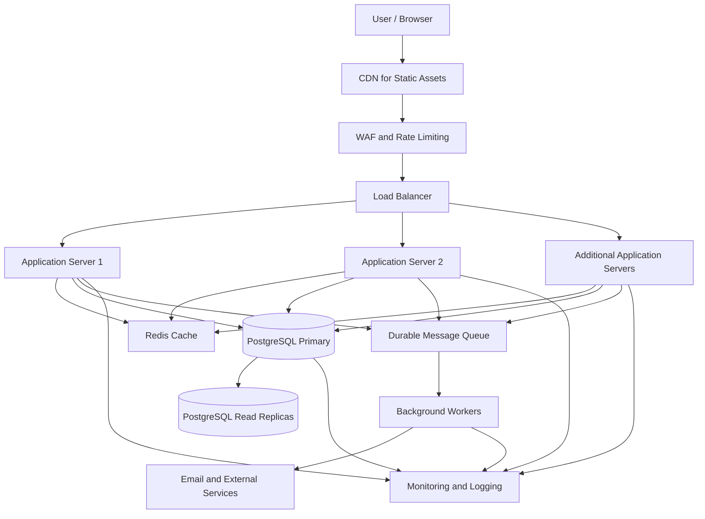

# QuickNotes System Architecture

## 1. Overview

QuickNotes is a browser-based notes application that allows users to create, view, update, organise and delete personal notes.

The current application uses HTML, CSS, JavaScript and the JSONPlaceholder REST API for demonstration purposes. This document proposes a scalable production architecture designed to support approximately one million registered users.

The proposed production system introduces a backend API, authentication, a relational database, caching, load balancing, background processing and monitoring.

## 2. Scalability Assumptions

The following figures are planning assumptions, not measured application traffic.

- Registered users: 1,000,000
- Daily active users: 200,000, representing 20% of registered users
- Requests per active user per day: 30
- Estimated daily API requests: 6,000,000
- Average request rate: approximately 70 requests per second
- Estimated peak request rate: approximately 700 requests per second, assuming traffic reaches ten times the average
- Estimated traffic distribution: 90% reads and 10% writes

These estimates provide a starting point for capacity planning. Actual infrastructure requirements must be determined through load testing, monitoring and observed usage patterns.

## 3. System Components

### 3.1 Client Application

The browser interface uses HTML, CSS and JavaScript. It displays notes, handles user interactions and communicates with the backend through HTTPS requests.

### 3.2 Content Delivery Network (CDN)

A CDN serves static files such as JavaScript, CSS, images and other frontend assets from geographically distributed locations. This reduces latency and decreases traffic reaching the application servers.

### 3.3 Web Application Firewall and Rate Limiting

A Web Application Firewall (WAF) helps filter malicious requests. Rate limiting restricts excessive requests from individual users or clients to reduce abuse and protect system resources.

### 3.4 Load Balancer

The load balancer distributes incoming API requests across multiple application server instances. Health checks help prevent traffic from being sent to unhealthy instances.

### 3.5 Backend API Servers

The backend exposes REST endpoints for authentication, notes and tags. It validates requests, checks permissions, applies business rules and communicates with the database and cache.

Application servers are stateless wherever practical, allowing additional instances to be deployed as demand increases.

### 3.6 Authentication and Authorisation

Authentication verifies a user's identity. Authorisation ensures users can access only their own notes and permitted resources. Passwords must be stored using an appropriate password-hashing algorithm, never as plain text.

### 3.7 Redis Cache

Redis stores suitable frequently accessed data, such as selected note lists or session-related information where appropriate. Cache expiration and invalidation rules help prevent stale data from being served.

The database remains the authoritative source of persistent application data.

### 3.8 PostgreSQL Database

PostgreSQL stores users, notes, tags and note-tag relationships in relational tables.

The primary database handles writes. Read replicas can serve suitable read queries to reduce read pressure on the primary database. Replication lag and failover must be considered when designing the system.

### 3.9 Message Queue and Background Workers

A durable message queue accepts tasks that do not need to be completed during the initial API request. Background workers process jobs such as email notifications, exports and other time-consuming operations.

Workers should support retries and idempotent processing to reduce duplicate effects when jobs are retried.

### 3.10 Monitoring and Logging

Centralised logs, metrics, traces and alerts help the team identify errors, slow requests, resource exhaustion and database bottlenecks. Logs must avoid exposing passwords, access tokens or sensitive note content.

## 4. Proposed Architecture Diagram

## 5. Request and Data Flow

### Reading Notes

1. The user opens QuickNotes in a browser.
2. The browser loads static assets through the CDN.
3. The user signs in and requests their notes over HTTPS.
4. The request passes through the WAF and load balancer.
5. An application server authenticates the request and checks authorisation.
6. The server checks Redis for suitable cached data.
7. If the required data is not cached, the server queries PostgreSQL, using a read replica when appropriate.
8. The API returns the authorised notes to the browser.
9. Cache entries are updated or invalidated according to the application's caching rules.

### Creating or Updating Notes

1. The browser sends a validated request to the backend API.
2. The backend authenticates the user and verifies that the requested operation is permitted.
3. PostgreSQL commits the change to persistent storage.
4. Related cache entries are invalidated or refreshed.
5. The API returns an appropriate success response.
6. If additional work is required, the backend can publish a message for a background worker.

The database write must succeed before the API reports that a note has been saved. Background processing should not be used as a substitute for persisting the note itself.

### Deleting Notes

1. The browser sends a DELETE request for the selected note.
2. The backend verifies the user's identity and ownership of the note.
3. PostgreSQL processes the deletion.
4. Relevant cached data is invalidated.
5. The API returns a suitable success response.

## 6. Scaling and Reliability

- **Horizontal scaling:** Add application server instances when request volume increases.
- **Load balancing:** Distribute requests across healthy application instances.
- **Caching:** Reduce repeated database queries for suitable read-heavy operations.
- **Database optimisation:** Use indexes, connection pooling and query analysis to improve database performance.
- **Read replicas:** Distribute suitable read traffic while accounting for replication lag.
- **Background processing:** Move slow, non-essential tasks out of the immediate user request.
- **Fault tolerance:** Use health checks, retries with limits, database backups and tested recovery procedures.
- **Security:** Enforce HTTPS, validate inputs, protect credentials and apply per-user access controls.
- **Observability:** Monitor latency, request rates, error rates, CPU, memory, cache performance and database connections.

Potential bottlenecks include database writes, expensive queries, cache misses, connection limits and queue backlogs. Load testing and monitoring should guide further infrastructure changes.

## 7. Limitations and Trade-offs

Redis improves performance but introduces cache invalidation complexity and additional infrastructure to maintain.

Read replicas improve read capacity but can return slightly outdated data because replication may not be instantaneous.

Background workers improve responsiveness for non-essential tasks, but introduce queue management, retry and monitoring requirements.

Multiple application servers and database replicas increase availability and capacity, but also increase operational cost and complexity. The system should grow according to measured demand rather than deploying every component prematurely.

## 8. Current Demo Versus Proposed Production System

The current QuickNotes demonstration uses JavaScript and JSONPlaceholder to practise API requests. JSONPlaceholder simulates resource creation and deletion; it does not provide persistent storage for these demonstration changes.

The architecture described here is a proposed production design, not a claim that the current demo already implements a backend, Redis, PostgreSQL replicas, a queue or load balancing.

A practical implementation path is to introduce a backend API and persistent database first, then add caching, replicas and background processing when usage and performance measurements justify them.

## 9. Future Improvements

- Implement a production backend and PostgreSQL database.
- Add secure authentication and per-user authorisation.
- Implement complete note and tag management.
- Add automated unit, integration and load tests.
- Configure backups, recovery procedures and monitoring.
- Introduce caching and read replicas based on measured workload.
- Improve accessibility and mobile responsiveness.
